# CRAZE

**2D resistance simulation for thin-film layouts.**

CRAZE reads a GDSII layout and computes the electrical resistance of a thin-film
structure together with its potential, current density and power density. It is meant
for designing thin-film resistors, heaters, temperature sensors such as Pt100/Pt1000
meanders, and similar MEMS structures, where corners, contact pads and current crowding
make the simple *length / width* estimate inaccurate.

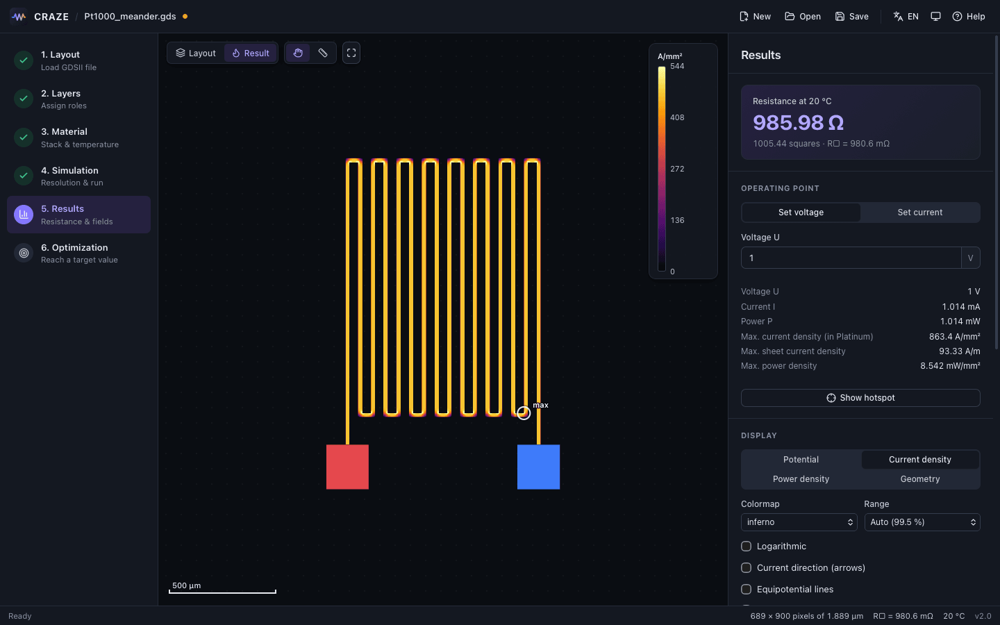

- Reads binary GDSII and KLayout GDS2 text, including cell hierarchy (SREF/AREF,
  rotation, mirroring, magnification) and all path types.
- Exact-area rasterization with a sub-pixel edge model, so slanted and curved edges are
  handled well even at moderate resolutions.
- Any number of terminals: plus, minus and floating sense contacts for four-wire
  (Kelvin) structures.
- Material stack with temperature coefficients, so R(T) is available for sensor design.
- Hotspot finder, current direction arrows, equipotential lines, cross-sections with
  current through the cut line, and a resolution study that estimates the
  discretization error.
- Width optimizer that scales the path widths until a target resistance is reached and
  writes a new GDSII file.
- Desktop app for macOS and Windows plus a command line tool.

## Contents

- [Download](#download)
- [Opening an unsigned build](#opening-an-unsigned-build)
- [User guide](#user-guide)
- [Preparing layouts in KLayout](#preparing-layouts-in-klayout)
- [Concepts](#concepts)
- [Command line](#command-line)
- [How it works](#how-it-works)
- [Keyboard shortcuts](#keyboard-shortcuts)
- [Building from source](#building-from-source)
- [License](#license)

## Download

Every push to `main` is built automatically and published as the
[**Latest CRAZE Release**](https://github.com/BTFLV/CRAZE/releases/tag/latest):

| Platform | File |
| --- | --- |
| macOS, Apple Silicon and Intel | [`CRAZE-macOS-universal.dmg`](https://github.com/BTFLV/CRAZE/releases/download/latest/CRAZE-macOS-universal.dmg) |
| Windows 10/11 x64, installer | [`CRAZE-Windows-x64-setup.exe`](https://github.com/BTFLV/CRAZE/releases/download/latest/CRAZE-Windows-x64-setup.exe) |
| Windows 10/11 x64, MSI | [`CRAZE-Windows-x64.msi`](https://github.com/BTFLV/CRAZE/releases/download/latest/CRAZE-Windows-x64.msi) |

The release notes list the commit the build was made from and whether it is signed.

## Opening an unsigned build

Until code-signing certificates are set up, the builds are not signed by a known
developer, and both operating systems warn on first start.

**macOS.** Open the DMG and drag CRAZE into *Applications*. The first time you start
it, macOS reports that it cannot verify the app. Close the dialog, open
*System Settings → Privacy & Security*, scroll down to the message about CRAZE, click
**Open Anyway** and confirm. You only need to do this once. If macOS instead says the
app is *damaged*, remove the download quarantine flag in Terminal:

```sh
xattr -dr com.apple.quarantine /Applications/CRAZE.app
```

**Windows.** SmartScreen shows *Windows protected your PC*. Click **More info**, then
**Run anyway**. The installer installs CRAZE for the current user. It uses the WebView2
runtime that ships with Windows 10/11 and downloads it if it is missing.

## User guide

The app guides you through six steps in the left sidebar. You can go back to any step
at any time. The interface is available in English and German (language button in the
top bar).

### 1. Layout

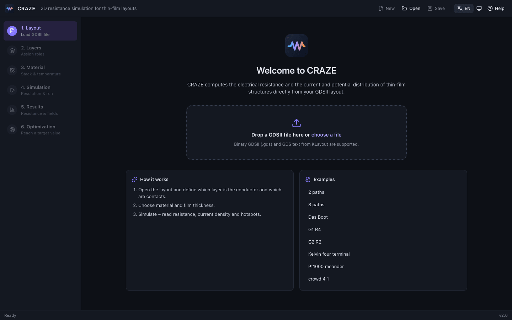

Open a GDSII file with **Open**, by dragging it onto the window, or pick one of the
bundled examples. Binary GDSII (`.gds`) and KLayout GDS2 text (`.gds2`, `.txt`) are
supported. If a file has several top cells, CRAZE picks the one with the most shapes;
you can choose another cell in this step.

### 2. Layers

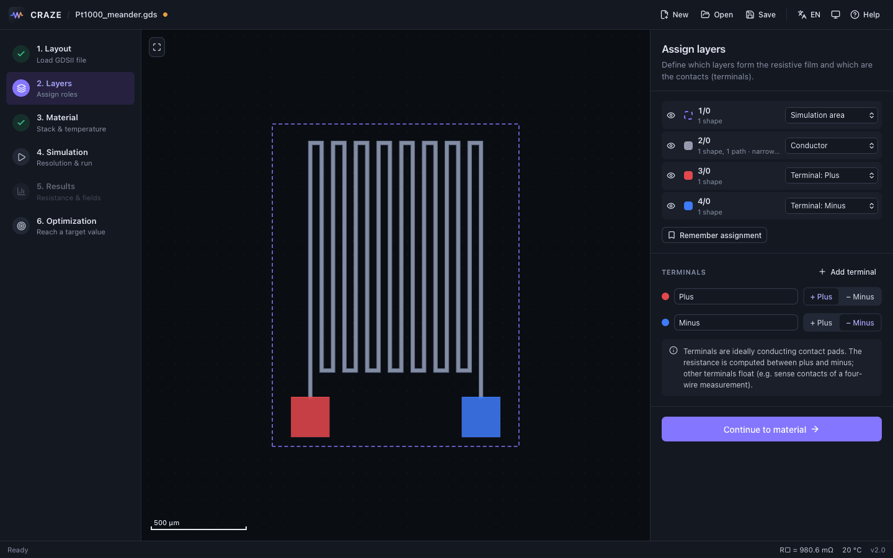

Give every layer a role:

| Role | Meaning |
| --- | --- |
| Conductor | The resistive film. Several layers can be conductors; they are merged into one sheet. |
| Terminal | An ideally conducting contact pad. Several layers can belong to the same terminal. |
| Simulation area | Optional. Limits the simulated area. Without it, the bounding box of conductor and terminals is used. |
| Ignore | Not used. |

The resistance is computed between the terminal marked **+ Plus** and the one marked
**− Minus**. Use **Add terminal** for further contacts; they are *floating* (see
[Four-wire measurements](#four-wire-measurements-and-floating-terminals)).
CRAZE suggests an assignment when a layout is opened. **Remember assignment** stores the
current assignment and applies it automatically to layouts with the same set of layers.

### 3. Material

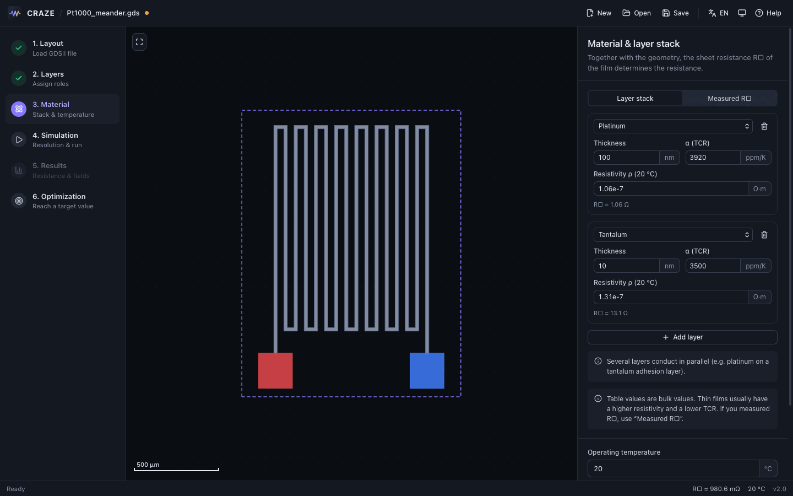

Describe the film either as a **layer stack** (material and thickness per layer; the
layers conduct in parallel, for example 100 nm platinum on a 10 nm tantalum adhesion
layer) or as a **measured sheet resistance** R□ with its temperature coefficient and
reference temperature. The **operating temperature** scales all values through the
temperature coefficients.

The material table holds bulk values. Thin films usually have a higher resistivity and a
lower temperature coefficient than bulk material, so if you have a measured R□, use it.

### 4. Simulation

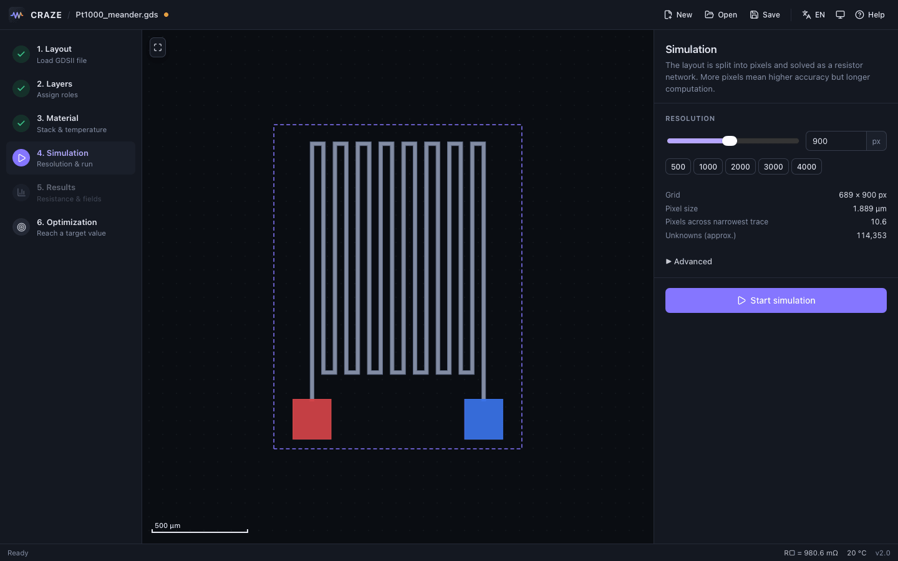

Choose the resolution, i.e. the number of pixels along the longer side of the simulated
area. CRAZE shows the resulting grid, pixel size, the number of pixels across the
narrowest trace and an estimate of the number of unknowns, and it proposes a resolution
when a layout is opened. See [Choosing a resolution](#choosing-a-resolution).

Under *Advanced* you can force the direct or the iterative solver; the default
*Automatic* is the right choice almost always.

### 5. Results


The result card shows the resistance at the operating temperature, the number of squares
and the sheet resistance used. Below it you find:

- **Operating point.** Set a voltage or a current; CRAZE derives current, voltage, power,
  the maximum current density (in A/mm² in the most conductive layer of the stack, or as
  sheet current density in A/m for a measured R□) and the maximum power density.
- **Show hotspot** zooms to the pixel with the highest current density.
- **Display.** Potential, current density, power density or plain geometry; colormap,
  logarithmic scale, color range (99.5th percentile or full range), current direction
  arrows, equipotential lines and layout outlines. Hovering over the field shows the local
  values.
- **Terminals.** Potential of every terminal and, with two floating terminals, the
  four-wire resistance.
- **Cross-section.** Draw a line across a trace to plot the field along it and to get the
  current through the line.
- **Temperature dependence.** R(T) from −50 °C to 400 °C.
- **Accuracy.** A resolution study (see below).
- **Export.** Field image (PNG) and an HTML report.

Material, temperature and operating point apply immediately. Changes to the geometry,
layers or resolution mark the result as outdated until you simulate again.

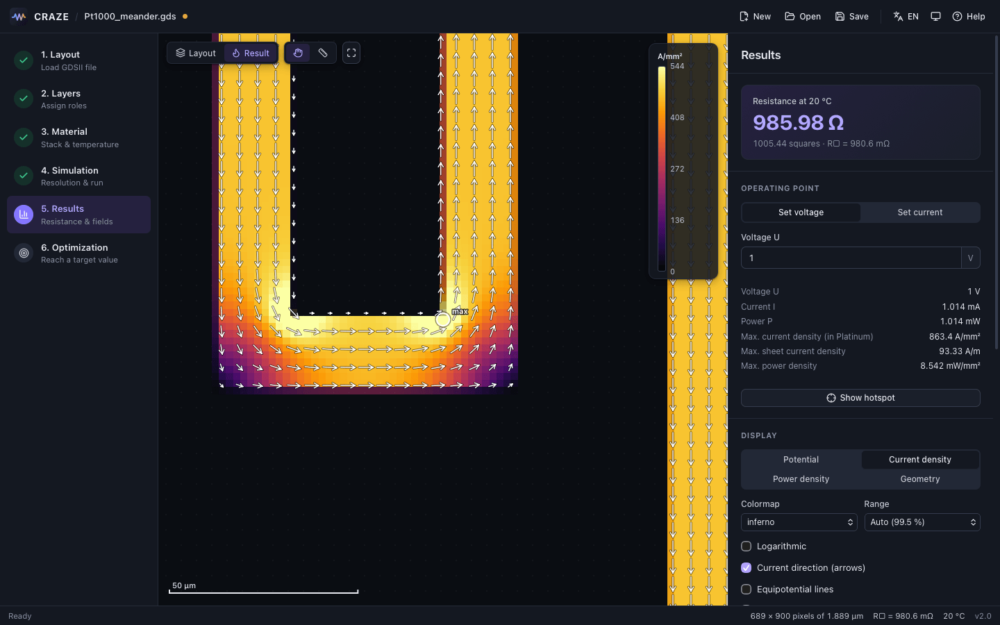

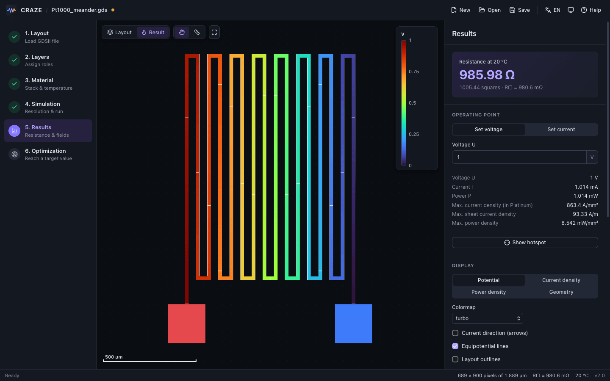

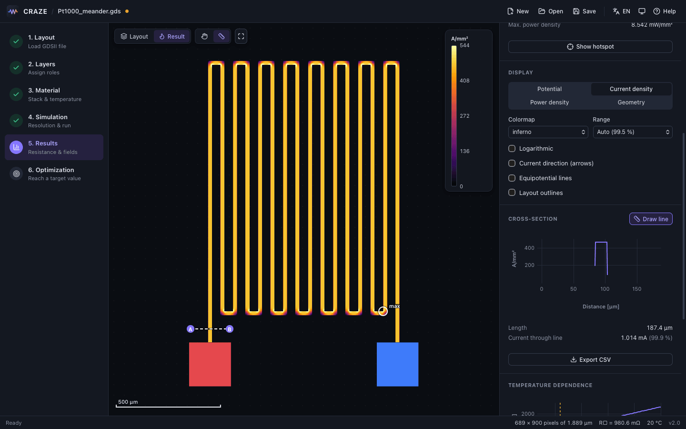

### 6. Optimization

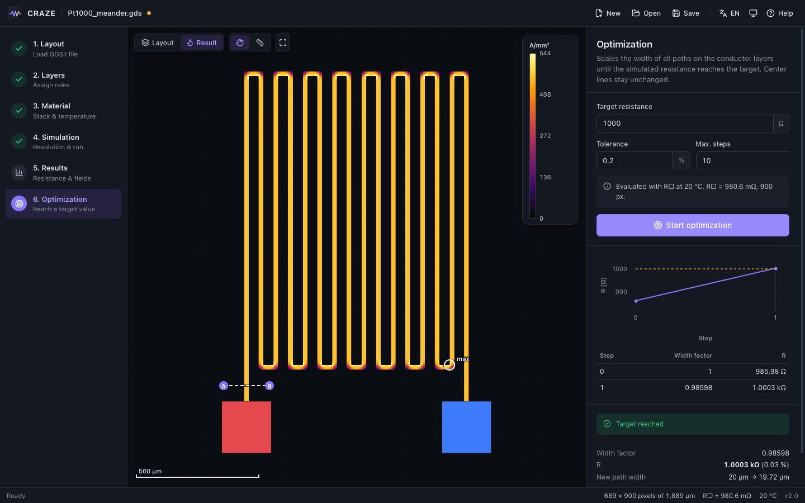

Enter a target resistance (for example 1000 Ω for a Pt1000 at 0 °C, after setting the
operating temperature to 0 °C in the material step), a tolerance and the maximum number of
steps. The optimizer scales the width of **all paths on the conductor layers** by a common
factor until the simulated resistance hits the target, usually within two or three
simulations. Centerlines stay where they are; polygons and terminal shapes are not
changed. **Save optimized layout** writes a binary GDSII file that is identical to the
input except for the modified path widths. See [Optimizer](#optimizer).

Projects (layout path, layer assignment, material, settings, view options) can be saved
as `.craze` files with **Save** and opened again like a layout.

## Preparing layouts in KLayout

- **Draw traces as paths.** A path with a width is the natural representation of a
  trace and the only thing the optimizer can change. Polygons simulate just as well, but
  their width cannot be optimized.
- **Put contact pads on their own layers.** Each terminal needs at least one layer of
  its own. Pads may overlap the trace; where they do, the pad wins, because it is treated
  as an ideal conductor. Two different terminals must not touch.
- **Optionally add a simulation area** on its own layer, a rectangle around the
  structure. It is useful when you want a fixed grid independent of small layout changes.
- **Save as GDS2** (binary), KLayout's default. KLayout GDS2 text works as well.
- **Default layer convention.** If a layout has layers 2, 3 and 4, CRAZE assigns roles
  automatically:

  | Layer | Role |
  | --- | --- |
  | 1 | Simulation area |
  | 2 | Conductor |
  | 3 | Terminal *Plus* |
  | 4 | Terminal *Minus* |

  Any datatype is accepted. Other layouts get a suggestion based on area: the largest
  layer with paths becomes the conductor and the two smallest layers become terminals.
  Check the suggestion in step 2.

## Concepts

### Squares and sheet resistance

For a thin film of uniform thickness the resistance factors into

    R = N · R□

R□, the sheet resistance in Ω/□, depends only on the material and the thickness
(R□ = ρ / t for a single layer). N, the number of squares, depends only on the geometry: a
straight strip of length L and width W has N = L / W. Corners, pads, width changes and
current crowding change N in ways that are hard to estimate by hand; computing N is what
CRAZE does. Because the simulation produces N, changing material or temperature
afterwards does not require a new simulation.

### Four-wire measurements and floating terminals

Terminals other than plus and minus are *floating*: they carry no net current, and CRAZE
solves for their potential. This models the sense contacts of a four-wire (Kelvin)
measurement. With exactly two floating terminals, the results show the voltage between
them and the four-wire resistance ΔU / I, which excludes the resistance of the supply
leads.

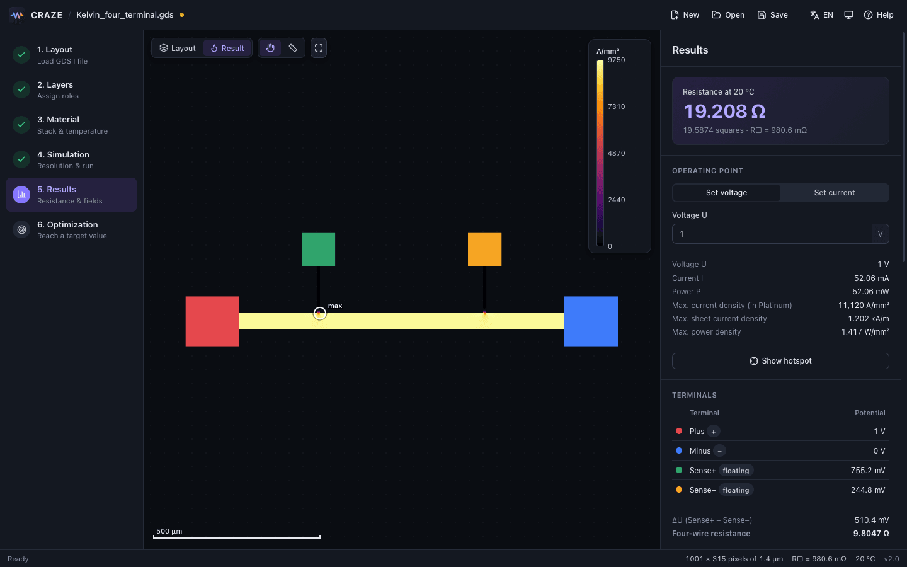

The *Kelvin four terminal* example has supply pads on layers 3/0 and 4/0 and sense pads
on 5/0 and 6/0. To reproduce the screenshot, add two terminals in step 2 and assign
layers 5/0 and 6/0 to them.

A floating terminal is an ideal conductor, so where it overlaps the trace it shorts that
part of the trace. Keep sense taps narrow and outside the region whose resistance you
want to measure, as in the example.

### Temperature and TCR

Each material has a resistivity ρ at 20 °C and a linear temperature coefficient α:

    ρ(T) = ρ(20 °C) · (1 + α · (T − 20 °C))

The layers of a stack conduct in parallel, so the stack has an effective TCR that is
shown in the material step. In *measured R□* mode you enter R□ and α at a reference
temperature directly. The geometry factor N does not depend on temperature, so the
R(T) curve in the results is N · R□(T). Self-heating is not modeled: the whole structure
is assumed to be at the operating temperature.

### Choosing a resolution

The layout is divided into square pixels, so accuracy depends on how many pixels span the
narrowest trace. **Aim for at least 10 pixels across the narrowest trace.** CRAZE proposes
such a resolution when a layout is opened, shows the pixels per trace width in step 4 and
warns after a simulation if the trace is narrower than that. Thanks to the sub-pixel edge
model, 10 pixels usually give errors well below 1 %.

The **resolution study** in the results simulates the same structure at ¼, ½, 1 and 2
times the current resolution (the last one only up to 4000 pixels), plots the number of
squares, and uses Richardson extrapolation on the last three points to estimate the value
for infinitely fine pixels and the remaining error at the current resolution. If the
estimated error is too large for your purpose, increase the resolution.

Memory and time grow with the number of unknowns (roughly the number of conductor
pixels). As a reference, the Pt1000 example takes about 2 s at 4000 pixels (2.3 million
unknowns) and 7 s at 6000 pixels (5.1 million unknowns) on an Apple M-series laptop. Above
8 million unknowns CRAZE switches to an iterative solver that needs much less memory.

### Hotspot and cross-section current

The **hotspot** is the conductor pixel with the highest current density. In thin-film
heaters and sensors it is almost always the inner corner of a bend, where current
crowds; it limits the maximum current before electromigration or local overheating.
Note that at a sharp inner corner the current density of the ideal continuum solution
is infinite, so the hotspot value grows with the resolution. Treat it as an indicator for
comparing designs, not as an exact number.

The **cross-section** tool samples the displayed field along a line and integrates the
current density component normal to the line. For a line that cuts a trace completely,
the *current through line* equals the total current (the percentage next to it shows the
ratio), which is a quick consistency check and lets you see how current splits between
parallel branches. The data can be exported as CSV.

### Optimizer

The optimizer scales all path widths on the conductor layers by one factor *s*. Since R is
roughly proportional to 1/s, it starts with s = R(1) / R_target and refines with a secant
iteration on log R versus log s, which typically converges in two or three steps. Each
step is a full simulation at the current resolution and uses the sheet resistance at the
current operating temperature. The written GDSII keeps every record of the original file
and only changes the `WIDTH` of the affected paths (rounded to the database unit). Paths
inside a cell that is placed several times are scaled everywhere that cell is used.

## Command line

The command line tool `craze` runs the same engine without the GUI, for batch runs and
scripting. It is not part of the app download; build it from source with
`cargo install --path crates/craze-cli` (see [Building from source](#building-from-source)).

```sh
# Cells, layers and the suggested layer assignment
craze info examples/Pt1000_meander.gds

# Resistance with the suggested assignment and R□ = 0.98 Ω/□
craze simulate examples/Pt1000_meander.gds --res 2000 --rsheet 0.98

# Explicit layers: conductor, plus, minus, two floating sense terminals; JSON output
craze simulate examples/Kelvin_four_terminal.gds --conductor 2/0 \
    --terminal 3/0 --terminal 4/0 --terminal 5/0 --terminal 6/0 --region 1/0 --json

# Resolution study
craze sweep examples/Pt1000_meander.gds --resolutions 500,1000,2000,4000

# Scale path widths to reach 1000 Ω and write a new layout
craze optimize examples/Pt1000_meander.gds --target 1000 --rsheet 0.98 --out meander_1k.gds
```

| Option | Meaning |
| --- | --- |
| `--conductor L/D` | Conductor layer, repeatable. Without `--conductor` and `--terminal`, the automatic suggestion is used. |
| `--terminal L/D[,L/D…]` | Terminal layers, repeatable. The first terminal is plus, the second minus, all further ones are floating. |
| `--region L/D` | Layer that defines the simulation area. |
| `--top NAME` | Top cell (default: the first top cell). |
| `--res N` | Pixels along the longer side (default 1000). |
| `--solver auto\|direct\|iterative` | Linear solver (default `auto`). |
| `--rsheet R` | Sheet resistance in Ω/□ (default: 100 nm Pt on 10 nm Ta at 20 °C, ≈ 0.98 Ω/□). |
| `--json` | (`simulate`) Print the full summary, including all terminal potentials, as JSON. |
| `--target`, `--tol`, `--iterations`, `--out` | (`optimize`) Target in Ω, relative tolerance (default 0.002), maximum steps (default 10), output file. |

`craze --help` and `craze <command> --help` list all options. Progress messages, warnings
and errors that come from the simulation engine are currently in German, in the app as well
as in the CLI.

## How it works

1. The GDSII hierarchy is flattened into polygons; paths are expanded into outlines.
2. All shapes of each role are merged with a boolean union and rasterized with exact area
   coverage per pixel.
3. Every conductor pixel becomes a node of a resistor network (a finite-volume
   discretization). In partially covered edge pixels, a straight material edge is
   reconstructed from the neighbouring coverage, which determines the conductances to the
   neighbouring pixels.
4. Each terminal is one equipotential node: plus at 1 V, minus at 0 V, others floating.
   Conductor islands that touch no terminal are removed.
5. The sparse symmetric positive definite system is solved with a sparse Cholesky
   factorization, or with conjugate gradients and an incomplete Cholesky preconditioner for
   very large problems.
6. The current leaving the plus terminal gives the number of squares; potential and current
   density fields are scaled to the chosen operating point in the app.

The solver is validated against analytic solutions (straight and rotated bars, a Corbino
ring, a 90° corner) and the geometry import against KLayout. Details are in the developer
documentation:

- [Architecture](docs/architecture.md): crates, data flow, IPC, state and rendering
- [Numerics](docs/numerics.md): discretization, solvers, validation and limitations
- [Building](docs/building.md), [Testing](docs/testing.md), [Releasing](docs/releasing.md)

## Keyboard shortcuts

| Key | Action |
| --- | --- |
| <kbd>F</kbd> or double click | Fit the layout into the view |
| <kbd>Esc</kbd> | Back to the pan tool (from the cross-section tool) |
| <kbd>Ctrl</kbd>/<kbd>⌘</kbd> + <kbd>O</kbd> | Open layout or project |
| <kbd>Ctrl</kbd>/<kbd>⌘</kbd> + <kbd>S</kbd> | Save project |
| <kbd>Ctrl</kbd>/<kbd>⌘</kbd> + <kbd>Enter</kbd> | Start simulation |
| Mouse wheel / pinch | Zoom |
| Drag | Pan (or draw a cross-section with the ruler tool) |

The app follows the system appearance by default; the button next to the language switch
cycles between system, light and dark.

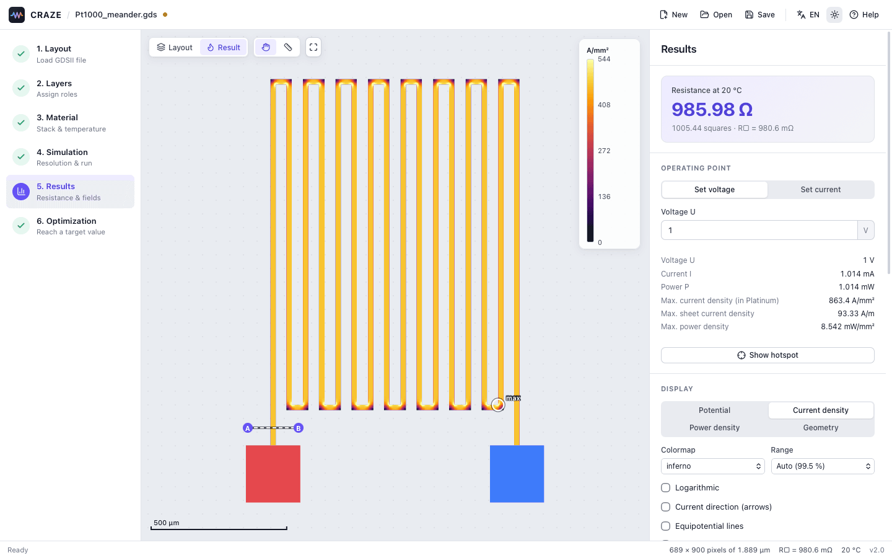

## Building from source

You need Rust (stable) and Node.js with npm.

```sh
cd app
npm install
npx tauri dev      # development build with hot reload
npx tauri build    # release bundle in target/release/bundle
```

See [docs/building.md](docs/building.md) for platform notes, the CLI and the workspace
layout.

## License

CRAZE is released under the [MIT License](LICENSE).
