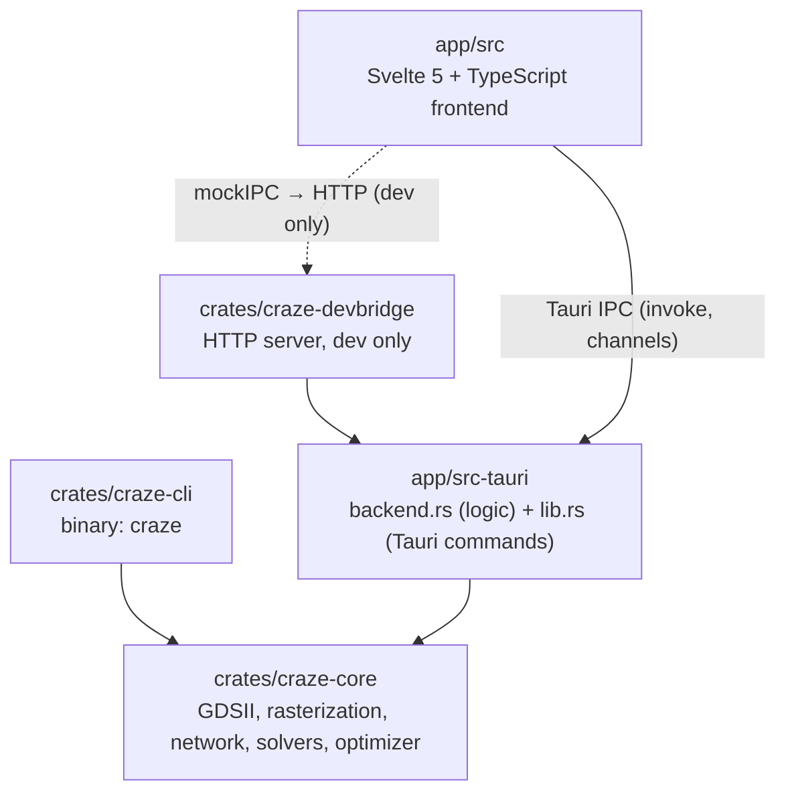
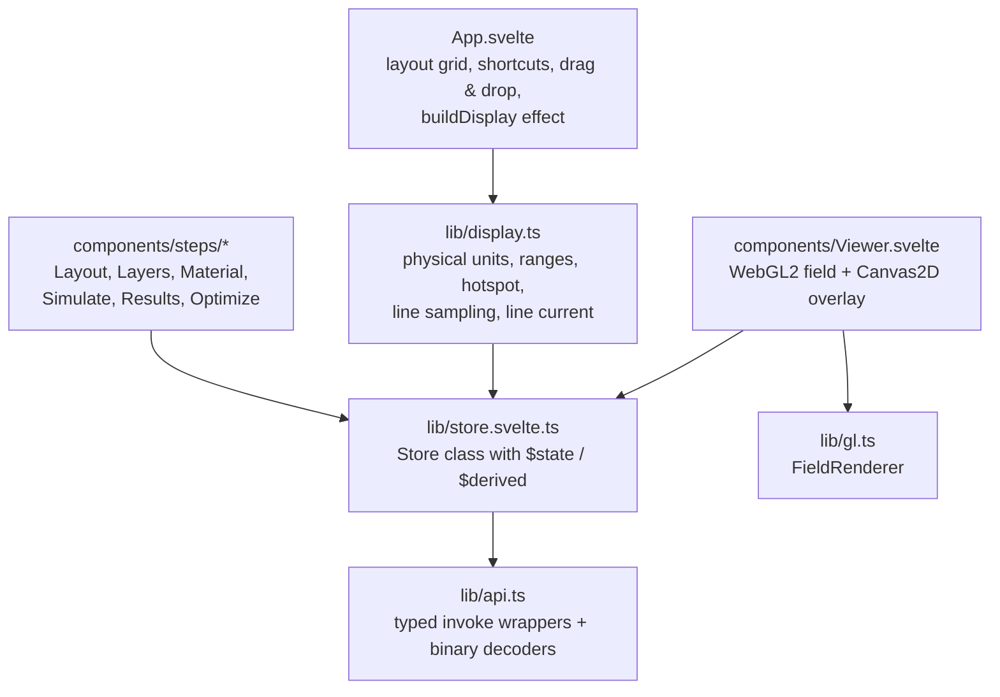

# Architecture

CRAZE is a Cargo workspace with a GUI-free simulation library, a command line tool, the
Tauri desktop app and a development-only HTTP bridge.



| Path | Contents |
| --- | --- |
| `crates/craze-core` | Library with no GUI dependencies. All physics and numerics. |
| `crates/craze-cli` | `craze` binary: `info`, `simulate`, `sweep`, `optimize`. |
| `app/src-tauri` | Tauri 2 application crate (`craze-app`, library `craze_app_lib`). |
| `app/src` | Frontend (Svelte 5 with runes, TypeScript, Vite). |
| `crates/craze-devbridge` | Serves the backend over HTTP for browser-based UI tests. Never shipped. |
| `examples/` | Example layouts, bundled with the app as resources. |
| `scripts/` | Screenshot generator for the README. |

## craze-core

| Module | Responsibility |
| --- | --- |
| `gds::records` | GDSII record layer: binary stream reader/writer and the KLayout GDS2 text reader. Both produce the same `Vec<Record>`. Unknown records are kept verbatim. |
| `gds` | `Library` (structures and elements parsed from the records), top-cell detection, hierarchy flattening into a `FlatLayout` of polygons in µm, and `with_scaled_path_widths` for the optimizer. |
| `geometry` | `Pt`, `Affine` (GDSII STRANS/MAG/ANGLE placement), `BBox`, signed area, path expansion (`path_to_polygon`). |
| `setup` | `Setup` (layer → role, terminals, plus/minus), `SimSettings` (resolution, solver, tolerance), validation and the automatic role suggestion. |
| `raster` | Simulation area and grid, boolean union with `i_overlay`, exact-area scan conversion into per-pixel coverage. |
| `network` | Resistor network: pixel classification, sub-pixel edge model, conductances, connectivity, assembly of the linear system. |
| `solver` | CSR matrix, sparse Cholesky (`faer`), PCG with IC(0). |
| `simulate` | The pipeline: rasterize → build → solve → post-process; `Summary`, `Stats`, `Fields`, progress reporting and cancellation. |
| `materials` | Material library (bulk values at 20 °C) and `Stack` → R□(T). |
| `optimize` | Width optimizer (secant iteration on log R over log s). |
| `error` | `CrazeError`. Messages are user-facing English; the app translates them for its German UI (`app/src/lib/messages.ts`). |

The numerical details are in [numerics.md](numerics.md).

### Data flow of a simulation

```mermaid
flowchart LR
    A["GDSII bytes"] --> B["records::read_binary / read_text"]
    B --> C["Library::from_records"]
    C --> D["Library::flatten(top)<br/>FlatLayout: polygons in µm per LayerKey"]
    D --> E["raster::rasterize<br/>coverage per pixel: conductor + one map per terminal"]
    E --> F["Network::build<br/>nodes, conductances, connectivity"]
    F --> G["Network::assemble<br/>SPD matrix A, right-hand side b"]
    G --> H["solve_direct / solve_pcg"]
    H --> I["compute_fields<br/>potential, jx, jy, material, coverage"]
    I --> J["Summary (squares, terminal potentials, stats, warnings)<br/>Fields"]
```



All results are normalized: V(plus) = 1, V(minus) = 0, R□ = 1. The number of squares is
`1 / I(plus)`. Physical units (volts, amperes, A/mm²) are applied in the frontend, so
material, temperature and operating point can change without a new simulation.

Long operations take an `AtomicBool` for cancellation and a progress callback; both are
checked between stages and inside the PCG loop. The direct solver cannot be interrupted
while it factorizes.

## Desktop app

### Backend (`app/src-tauri`)

`backend.rs` contains everything that is independent of Tauri:

- `Backend` holds the loaded layout (`Loaded`: path, `Library`, top cell, `FlatLayout`)
  and the last `SimOutput` behind mutexes, plus a cancel flag and a busy flag. Only one
  job (simulation, resolution study, optimization) runs at a time; `BusyGuard` resets the
  busy flag on every exit path.
- Layout metadata (`LayoutInfo`: layers with shape/path counts, areas, bounding boxes,
  minimum path width, labels, the suggested `Setup`).
- The binary encoders for layout geometry and result fields (below).
- Example discovery (`list_examples`) and the development examples directory.

`lib.rs` only declares the Tauri commands, moves heavy work to
`tauri::async_runtime::spawn_blocking`, forwards progress through `tauri::ipc::Channel`,
and handles preferences in the app config directory (`prefs.json`) and the command line
file argument.

| Command | Purpose |
| --- | --- |
| `open_layout(path, topCell?)` | Parse and flatten; returns `LayoutInfo`. Resets the last result. |
| `layout_geometry()` | Binary polygons for the preview. |
| `run_simulation(setup, settings, onProgress)` | Returns `Summary`; keeps `Fields` in the backend. |
| `result_fields()` | Binary fields of the last simulation. |
| `cancel_job()` | Sets the cancel flag. |
| `resolution_study(setup, settings, resolutions, onPoint)` | One simulation per resolution. |
| `run_optimization(…, onStep, onProgress)` | Width optimization. |
| `save_optimized_layout(path, scale, conductorKeys)` | Writes the scaled GDSII. |
| `material_library`, `list_examples`, `startup_file` | Static data. |
| `load_prefs`, `save_prefs` | Preferences JSON in the app config directory. |
| `read_text_file`, `write_text_file`, `write_base64_file` | File access for projects, CSV, reports and PNG export. |

### IPC binary formats

Large data is returned as raw bytes (`tauri::ipc::Response`), which arrive in the frontend
as an `ArrayBuffer`. All numbers are little-endian. The decoders are in `app/src/lib/api.ts`.

**`layout_geometry`** (polygons of all layers, coordinates relative to the layout center
to keep `f32` precision):

```text
f64 cx, f64 cy                     center of the layout bounding box (µm)
u32 layer_count
repeat layer_count:
    i32 layer, i32 datatype
    u32 polygon_count
    repeat polygon_count:
        u32 n
        n × (f32 x, f32 y)         µm, relative to (cx, cy)
```

Polygon data can start at any 4-byte offset, so the decoder copies each polygon
(`buf.slice`) before creating a `Float32Array`.

**`result_fields`** (n = nx · ny pixels, row-major, row 0 at the top):

```text
u32 nx, u32 ny
f32 potential[n]    normalized potential; NaN outside conducting pixels
f32 jx[n]           sheet current to the right, in "current per pixel width" for ΔV = 1, R□ = 1
f32 jy[n]           sheet current downwards (image coordinates)
f32 coverage[n]     material coverage 0..1 (conductor or terminal), for display
u8  material[n]     0 void, 1 conductor, 2 isolated conductor, 10 + id terminal
```

Total size 8 + 17 n bytes. The header is 8 bytes, so the `f32` arrays are aligned and are
used as views into the buffer without copying. The grid placement (`Grid`: `nx`, `ny`,
`pxUm`, `x0Um` = left edge, `y0Um` = top edge) comes with the `Summary`.

JSON types are serialized with `serde(rename_all = "camelCase")` and mirrored by hand in
`app/src/lib/types.ts`.

### Frontend (`app/src`)



**State.** `lib/store.svelte.ts` exports a single `Store` instance whose fields are Svelte
5 runes. It holds preferences, navigation, the project (layout, setup, settings, stack,
temperature, excitation), results, view options and the running job, and implements all
actions (open, simulate, study, optimize, save/open project). Notable derived values:

- `currentSignature`: JSON of layout path, top cell, setup and settings. A result is
  *stale* when it differs from the signature stored at simulation time. Material,
  temperature and operating point are not part of it because they do not change N.
- `problems`: setup errors shown before a simulation can start.
- `snapshot` / `dirty`: unsaved-changes tracking for projects.

Large typed arrays (`geometry`, `fields`, `display`) use `$state.raw` so Svelte does not
proxy them.

**Display pipeline.** An effect in `App.svelte` rebuilds `store.display` whenever the
fields, the selected quantity, the stack, temperature, operating point or range mode
change. `lib/display.ts` converts the normalized fields:

- sheet current density K = j · V / (R□ · pixel size) in A/m,
- volume current density J = K · σ · R□ in the most conductive stack layer (A/mm²),
- power density p = K² · R□ (W/mm²),
- color range from the 99.5th percentile (sampled) or min/max, logarithmic option,
- the hotspot (maximum over conductor pixels).

`lib/physics.ts` mirrors the material model of `craze-core` for instant updates.

**Rendering.** `Viewer.svelte` stacks two canvases:

- A WebGL2 canvas drawn by `lib/gl.ts`. The fields are uploaded as textures (`R32F` for
  values and potential, `R8` for material and coverage, a 256×1 colormap LUT). The
  fragment shader maps values through the LUT (linear or log), colors terminals and
  isolated islands, multiplies by coverage for anti-aliased edges, and draws
  equipotential lines by bilinear interpolation of the potential with a `fwidth`-based line
  width. NaN never reaches the GPU: NaNs are replaced by 0 on upload and validity comes from
  the material texture, because NaN handling is unreliable under fast-math drivers.
- A Canvas2D overlay for the layout preview (`Path2D` per layer, styled by role), current
  arrows (one per screen cell, placed on the nearest conductor sample), the cross-section
  line, the hotspot marker and the scale bar.

Pan and zoom live in a small camera (`cx`, `cy`, `scale` in px/µm). `lib/viewer.ts`
exposes `fit` and `snapshot` (PNG export of both canvases plus legend) to other
components.

**Internationalization.** `lib/i18n.ts` holds German (default) and English dictionaries;
`t("section.key", params)` looks up the current language. Numbers are formatted by
`lib/format.ts` with the locale in `lib/locale.svelte.ts`. Messages produced by
`craze-core` and the backend are English; `lib/messages.ts` translates them for the German UI.

**Persistence.**

- Preferences (`lang`, `theme`, `recent`, layer-role `presets`, `colormap`) are saved as
  `prefs.json` in the Tauri app config directory. Presets are keyed by the comma-separated
  list of layer keys of a layout.
- Projects are `.craze` JSON files:

  ```json
  {
    "format": "craze-project",
    "version": 1,
    "layoutPath": "/abs/path/layout.gds",
    "topCell": "TOP",
    "setup": { "layers": [], "terminals": [], "source": 0, "sink": 1 },
    "settings": { "resolution": 1000, "solver": "auto", "tolerance": 1e-10, "maxIterations": 200000 },
    "stack": { "mode": "layers", "layers": [] },
    "temperature": 20,
    "excitation": { "mode": "voltage", "value": 1 },
    "optimize": { "target": 1000, "tolerancePct": 0.2, "maxIterations": 10 },
    "view": { "field": "current", "colormap": "inferno", "log": false }
  }
  ```

  Results are not stored. If the layout is missing at `layoutPath`, the app looks for a
  file with the same name next to the project and then asks the user.

## Development bridge

`craze-devbridge` wraps the same `Backend` in a `tiny_http` server on
`127.0.0.1:1421` (`CRAZE_BRIDGE_PORT` overrides the port). Every command is
`POST /invoke/<command>` with the Tauri argument object as JSON body; binary results are
returned as `application/octet-stream`, errors as HTTP 400 with a JSON string.

When the frontend runs under Vite in a plain browser (`import.meta.env.DEV` and no
`__TAURI_INTERNALS__`), `main.ts` calls `installDevBridge()` from `lib/devbridge.ts`, which
installs Tauri's `mockIPC` and forwards every `invoke` to the bridge. Limitations:

- Progress channels are not forwarded (arguments with `onmessage` are sent as `null`).
- Native dialogs return `window.__crazeDialogPath` (set it from the test).
- Preferences are kept in memory; restart the bridge for a clean state.
- `write_base64_file` (PNG export) is a no-op; `startup_file` returns `CRAZE_TEST_FILE`.

The bridge reads and writes arbitrary files on request and allows any origin. Only run it
on a trusted machine while testing. See [testing.md](testing.md).
