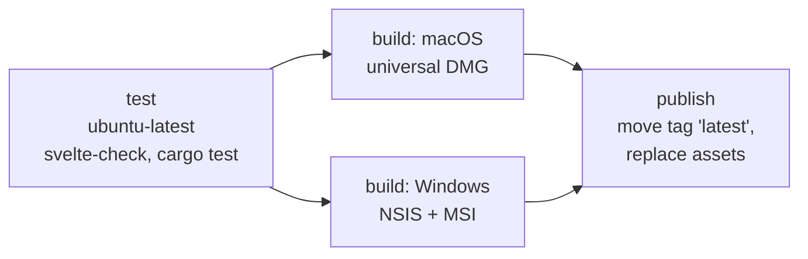

# Releasing

Releases are built by GitHub Actions in `.github/workflows/build.yml`. There is one
rolling release that always contains the newest build of `main`.

## Workflow overview



| Trigger | test | build | publish |
| --- | --- | --- | --- |
| push to `main` | yes | yes | yes |
| `workflow_dispatch` on `main` | yes | yes | yes |
| `workflow_dispatch` on another branch, pull requests | yes | yes | no |

Runs for the same branch are queued rather than cancelled, so a publish is never
interrupted halfway.

**test** builds the frontend (`app/dist` is required by Tauri's `generate_context!`, see
[building.md](building.md#the-appdist-pitfall)), runs `svelte-check` and
`cargo test --workspace` on Ubuntu with the WebKitGTK development packages.

**build** runs `tauri-apps/tauri-action@v1` in build-only mode (no release inputs):

- macOS (`macos-latest`): `--target universal-apple-darwin` with both Rust targets
  installed; one DMG for Apple Silicon and Intel.
- Windows (`windows-latest`): NSIS installer and MSI for x64.

The bundles are copied to stable names (`CRAZE-macOS-universal.dmg`,
`CRAZE-Windows-x64-setup.exe`, `CRAZE-Windows-x64.msi`) and uploaded as workflow
artifacts together with a small file stating the signing status.

**publish** handles the release with the GitHub CLI instead of letting tauri-action create
it, because tauri-action does not move tags or remove outdated assets:

1. Writes release notes with the commit SHA, subject and date, the build time, the file
   table and the signing status of each platform.
2. Moves the tag `latest` to the built commit (or creates it).
3. Creates or edits the release *Latest CRAZE Release*: not a draft, not a prerelease,
   marked as the latest release.
4. Uploads the new files with `--clobber` and deletes any other assets, so the release
   always holds exactly the files of the current build.

Because the file names are stable, these links always point to the newest build:

```text
https://github.com/BTFLV/CRAZE/releases/download/latest/CRAZE-macOS-universal.dmg
https://github.com/BTFLV/CRAZE/releases/download/latest/CRAZE-Windows-x64-setup.exe
https://github.com/BTFLV/CRAZE/releases/download/latest/CRAZE-Windows-x64.msi
```

The tag `latest` is force-moved on every build. Local clones that fetched it need
`git fetch --tags --force` to follow it.

## Checklist for the first run

The workflow can only be verified on GitHub. After the first push to `main`:

1. *Settings → Actions → General*: Actions must be allowed. The publish job requests
   `contents: write` itself; if the organization restricts workflow permissions to
   read-only, allow write access there.
2. In the run, the **Test** job should pass. It is the first job to compile the Tauri
   crate on Linux; failures here are usually missing system packages.
3. In **Build (macOS)** and **Build (Windows)**, the *Configure … signing* steps should
   print a notice *unsigned* (no secrets yet). The *Collect* steps print the signature
   check: an ad-hoc signature on macOS (Gatekeeper rejection is expected) and `NotSigned`
   on Windows.
4. **Publish rolling release** should create the tag `latest` and the release *Latest
   CRAZE Release* with exactly three files, marked *Latest*.
5. Download the DMG and the installer and check that they start after the confirmation
   described in the README.
6. Push a second commit and check that the tag moved, the release notes show the new SHA
   and the release still has exactly three files.

## Code signing

Signing is optional. Without secrets, every step is skipped and the builds are unsigned.
The *Configure … signing* steps export variables only when the corresponding secrets are
non-empty, because the Tauri bundler also tries to sign when a signing variable exists
with an empty value, and then fails the build.

Add secrets under *Settings → Secrets and variables → Actions → Secrets*.

### macOS

Requires a membership in the Apple Developer Program.

| Secret | Content |
| --- | --- |
| `APPLE_CERTIFICATE` | Base64 of a `.p12` export of the **Developer ID Application** certificate including its private key. |
| `APPLE_CERTIFICATE_PASSWORD` | Password chosen when exporting the `.p12`. |
| `APPLE_SIGNING_IDENTITY` | Name of the identity, e.g. `Developer ID Application: Jane Doe (ABCDE12345)`. |

Signing happens when `APPLE_CERTIFICATE` and `APPLE_SIGNING_IDENTITY` are set. For
notarization add **one** of these sets:

| Option | Secrets |
| --- | --- |
| Apple ID | `APPLE_ID` (Apple account e-mail), `APPLE_PASSWORD` (app-specific password), `APPLE_TEAM_ID` (10-character team ID) |
| App Store Connect API key | `APPLE_API_KEY` (key ID), `APPLE_API_ISSUER` (issuer ID), `APPLE_API_KEY_P8` (full text of the `AuthKey_<id>.p8` file) |

The workflow writes `APPLE_API_KEY_P8` to a file and passes its path as
`APPLE_API_KEY_PATH`, which is what Tauri expects.

How to create them:

1. In *Certificates, Identifiers & Profiles* on developer.apple.com, create a
   *Developer ID Application* certificate (from a certificate signing request made with
   *Keychain Access → Certificate Assistant*), download it and double-click to add it to
   the login keychain.
2. In *Keychain Access*, select the certificate together with its private key, *Export*,
   format `.p12`, and set a password.
3. `base64 -i certificate.p12 | pbcopy` and paste as `APPLE_CERTIFICATE`.
4. `security find-identity -v -p codesigning` shows the exact identity name for
   `APPLE_SIGNING_IDENTITY`.
5. Apple ID option: create an app-specific password at account.apple.com
   (*Sign-In and Security → App-Specific Passwords*); the team ID is shown in the developer
   account under *Membership*.
6. API key option: App Store Connect → *Users and Access → Integrations → App Store Connect
   API*, create a key with the *Developer* role, note key ID and issuer ID, and download the
   `.p8` file (possible only once).

Without a certificate the workflow signs the app ad hoc (`signingIdentity: "-"`). That is
not a trusted signature, but a universal binary needs a valid signature to launch at all
on Apple Silicon, and it allows users to open the app via *Privacy & Security → Open
Anyway*.

### Windows

The workflow supports a code-signing certificate as a password-protected `.pfx` file:

| Secret / variable | Content |
| --- | --- |
| `WINDOWS_CERTIFICATE` (secret) | Base64 of the `.pfx` file. |
| `WINDOWS_CERTIFICATE_PASSWORD` (secret) | Password of the `.pfx`. |
| `WINDOWS_TIMESTAMP_URL` (variable, optional) | RFC 3161 timestamp server, default `http://timestamp.digicert.com`. Set under *Variables*, not *Secrets*. |

Create the Base64 text with `base64 -i certificate.pfx | pbcopy` on macOS or
`[Convert]::ToBase64String([IO.File]::ReadAllBytes("certificate.pfx")) | Set-Clipboard`
in PowerShell.

The workflow imports the certificate into the runner's user certificate store and passes
`bundle.windows.certificateThumbprint`, `digestAlgorithm: "sha256"` and `timestampUrl` to
`tauri build` through a temporary `--config` file, so `tauri.conf.json` stays free of
signing settings. Tauri then signs the app executable and both installers with `signtool`.

Publicly trusted OV/EV code-signing certificates issued today are generally delivered on a
hardware token or in a cloud HSM and cannot be exported as `.pfx`. In that case use a
cloud signing service instead, for example **Azure Trusted Signing**:

1. Create a Trusted Signing account and certificate profile in Azure and an app
   registration (service principal) with the *Trusted Signing Certificate Profile Signer*
   role.
2. Store `AZURE_CLIENT_ID`, `AZURE_CLIENT_SECRET` and `AZURE_TENANT_ID` as secrets and
   export them in the Windows signing step.
3. Install [`trusted-signing-cli`](https://github.com/Levminer/trusted-signing-cli)
   (`cargo install trusted-signing-cli`) in the job and pass a custom sign command instead
   of the thumbprint:

   ```json
   {
     "bundle": {
       "windows": {
         "signCommand": "trusted-signing-cli -e https://<region>.codesigning.azure.net -a <account> -c <profile> -d CRAZE %1"
       }
     }
   }
   ```

See the Tauri guide on [Windows code signing](https://v2.tauri.app/distribute/sign/windows/)
for details. SmartScreen reputation builds up over time even for signed files; EV
certificates and Trusted Signing establish it faster.

## Versioned releases

The rolling release is meant for "always the newest build". For a fixed version:

1. Bump the version in `Cargo.toml`, `app/package.json` and
   `app/src-tauri/tauri.conf.json`, and commit.
2. After the workflow has run, download the artifacts of that run and create a release
   with a version tag (e.g. `v2.1.0`) by hand, or extend the workflow with a trigger on
   `v*` tags that publishes to that tag instead of `latest`.
