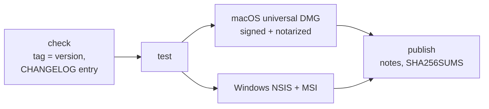

# Releasing

Two workflows live in `.github/workflows`:

- `ci.yml` runs on every push to `main`, on pull requests and on demand: `svelte-check`,
  `cargo test --workspace` (Ubuntu), and unsigned macOS (universal) and Windows builds that
  are kept as workflow artifacts for 14 days. It publishes nothing.
- `release.yml` runs when a tag `vX.Y.Z` is pushed and publishes the GitHub release
  *CRAZE X.Y.Z*.



## Making a release

1. Set the new version in `Cargo.toml` (`[workspace.package]`), `app/package.json`
   (and `app/package-lock.json` via `npm install`) and `app/src-tauri/tauri.conf.json`;
   run `cargo update -w` to update `Cargo.lock`.
2. Add a section `## X.Y.Z — YYYY-MM-DD` to `CHANGELOG.md`.
3. Commit, then tag and push: `git tag vX.Y.Z && git push origin main vX.Y.Z`.

The release workflow fails early if the tag does not match all three versions or the
changelog has no section for it. The release notes consist of that changelog section, a
download table and the signing status of each platform. Assets are
`CRAZE-X.Y.Z-macOS-universal.dmg`, `CRAZE-X.Y.Z-Windows-x64-setup.exe`,
`CRAZE-X.Y.Z-Windows-x64.msi` and `SHA256SUMS.txt`. Pushing the same tag again (after
deleting and re-creating it) refreshes the existing release.

Before 1.0.0 the project published a rolling release on the tag `latest`; the publish job
removes it if it still exists.

## Code signing

Signing is optional. Without secrets, every step is skipped and the builds are unsigned.
The *Configure signing* steps export variables only when the corresponding secrets are
non-empty, because the Tauri bundler also tries to sign when a signing variable exists
with an empty value, and then fails the build.

Add secrets under *Settings → Secrets and variables → Actions → Secrets*.

### macOS

Requires a membership in the Apple Developer Program.

| Secret | Content |
| --- | --- |
| `APPLE_CERTIFICATE` | Base64 of a `.p12` export of the **Developer ID Application** certificate including its private key. |
| `APPLE_CERTIFICATE_PASSWORD` | Password chosen when exporting the `.p12`. |
| `APPLE_SIGNING_IDENTITY` | Name of the identity, e.g. `Developer ID Application: Jane Doe (ABCDE12345)`. |

Signing happens when `APPLE_CERTIFICATE` and `APPLE_SIGNING_IDENTITY` are set. For
notarization add an App Store Connect API key: `APPLE_API_KEY` (key ID), `APPLE_API_ISSUER`
(issuer ID) and `APPLE_API_KEY_CONTENT` (full text of the `AuthKey_<id>.p8` file).

The workflow writes `APPLE_API_KEY_CONTENT` to a file and passes its path as
`APPLE_API_KEY_PATH`, which is what Tauri expects.

How to create them:

1. In *Certificates, Identifiers & Profiles* on developer.apple.com, create a
   *Developer ID Application* certificate (from a certificate signing request made with
   *Keychain Access → Certificate Assistant*), download it and double-click to add it to
   the login keychain.
2. In *Keychain Access*, select the certificate together with its private key, *Export*,
   format `.p12`, and set a password.
3. `base64 -i certificate.p12 | pbcopy` and paste as `APPLE_CERTIFICATE`.
4. `security find-identity -v -p codesigning` shows the exact identity name for
   `APPLE_SIGNING_IDENTITY`.
5. API key: App Store Connect → *Users and Access → Integrations → App Store Connect
   API*, create a key with the *Developer* role, note key ID and issuer ID, and download the
   `.p8` file (possible only once).

Without a certificate the workflow signs the app ad hoc (`signingIdentity: "-"`). That is
not a trusted signature, but a universal binary needs a valid signature to launch at all
on Apple Silicon, and it allows users to open the app via *Privacy & Security → Open
Anyway*.

### Windows

The workflow supports a code-signing certificate as a password-protected `.pfx` file:

| Secret / variable | Content |
| --- | --- |
| `WINDOWS_CERTIFICATE` (secret) | Base64 of the `.pfx` file. |
| `WINDOWS_CERTIFICATE_PASSWORD` (secret) | Password of the `.pfx`. |
| `WINDOWS_TIMESTAMP_URL` (variable, optional) | RFC 3161 timestamp server, default `http://timestamp.digicert.com`. Set under *Variables*, not *Secrets*. |

Create the Base64 text with `base64 -i certificate.pfx | pbcopy` on macOS or
`[Convert]::ToBase64String([IO.File]::ReadAllBytes("certificate.pfx")) | Set-Clipboard`
in PowerShell.

The workflow imports the certificate into the runner's user certificate store and passes
`bundle.windows.certificateThumbprint`, `digestAlgorithm: "sha256"` and `timestampUrl` to
`tauri build` through a temporary `--config` file, so `tauri.conf.json` stays free of
signing settings. Tauri then signs the app executable and both installers with `signtool`.

Publicly trusted OV/EV code-signing certificates issued today are generally delivered on a
hardware token or in a cloud HSM and cannot be exported as `.pfx`. In that case use a
cloud signing service instead, for example **Azure Trusted Signing**:

1. Create a Trusted Signing account and certificate profile in Azure and an app
   registration (service principal) with the *Trusted Signing Certificate Profile Signer*
   role.
2. Store `AZURE_CLIENT_ID`, `AZURE_CLIENT_SECRET` and `AZURE_TENANT_ID` as secrets and
   export them in the Windows signing step.
3. Install [`trusted-signing-cli`](https://github.com/Levminer/trusted-signing-cli)
   (`cargo install trusted-signing-cli`) in the job and pass a custom sign command instead
   of the thumbprint:

   ```json
   {
     "bundle": {
       "windows": {
         "signCommand": "trusted-signing-cli -e https://<region>.codesigning.azure.net -a <account> -c <profile> -d CRAZE %1"
       }
     }
   }
   ```

See the Tauri guide on [Windows code signing](https://v2.tauri.app/distribute/sign/windows/)
for details. SmartScreen reputation builds up over time even for signed files; EV
certificates and Trusted Signing establish it faster.
